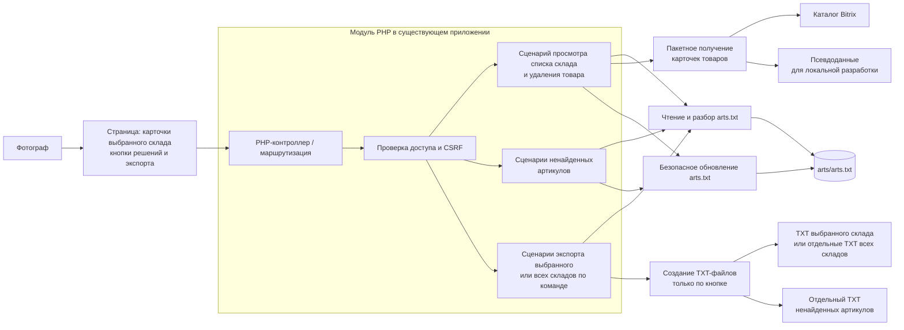
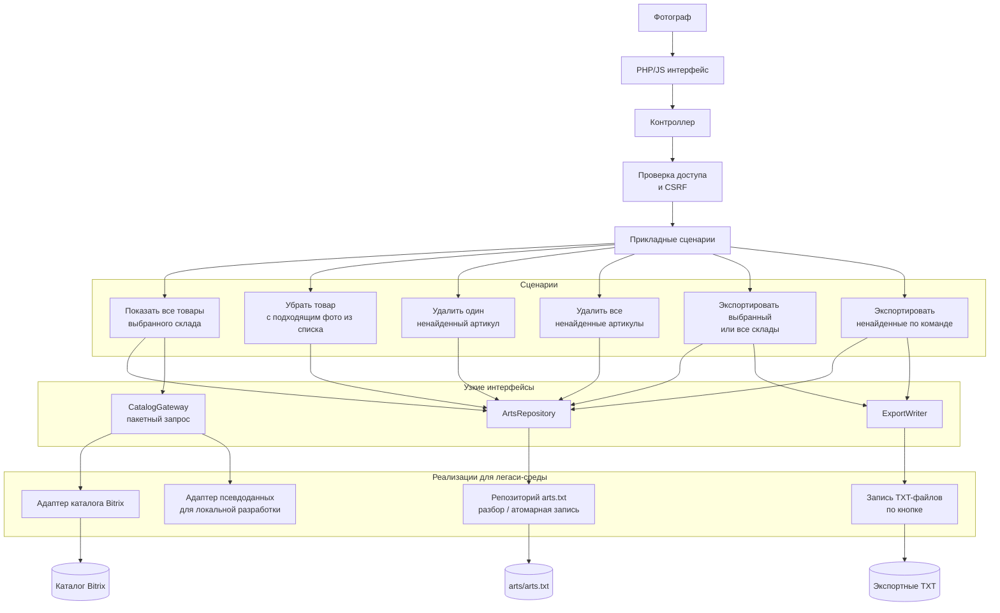
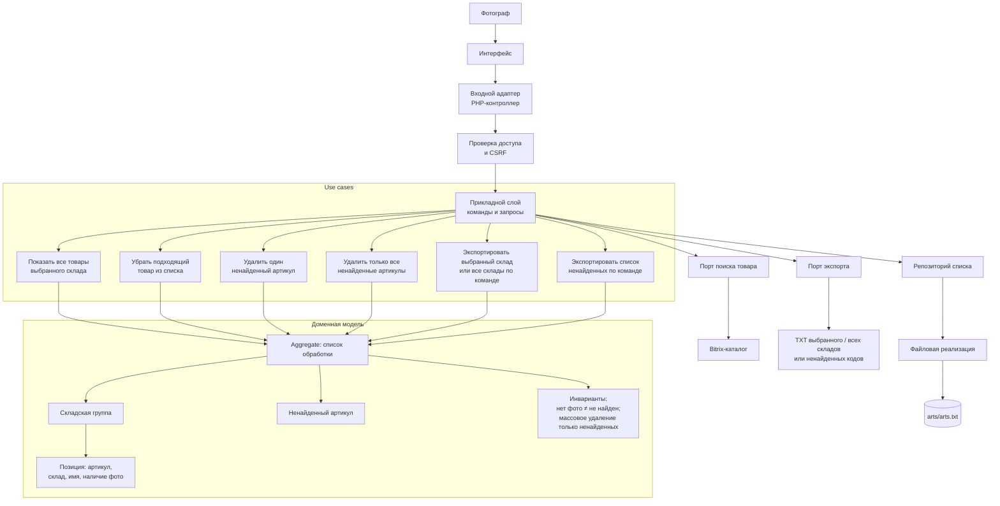
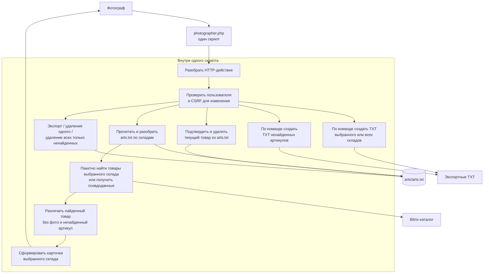

# Варианты реализации страницы фотографа

Схемы описывают четыре альтернативные организации одного и того же сценария, а не четыре отдельных продукта. Функциональные правила основаны на [ADR-0001](../adr/ADR-0001-photograf-selection-flow.md) и [ADR-0002](../adr/ADR-0002-exports-and-missing-articles.md); выбранный подход и отображение списка по складам описаны в [ADR-0003](../adr/ADR-0003-solid-photographer-module.md) и [ADR-0004](../adr/ADR-0004-warehouse-list-view.md).

## Общие правила сценария

- Фотограф выбирает склад и видит все его товары на одной странице, без чекбоксов и переходов по одному товару.
- Товар, найденный в базе без фотографии, остаётся в очереди своего склада и в его итоговом TXT.
- Артикулы, не найденные в базе, доступны отдельно: экспорт в TXT, удаление по одному или удаление всех таких артикулов.
- Складские TXT и TXT ненайденных артикулов формируются только по явной команде. Никакого автоматического экспорта нет.
- Удаление меняет текущий `arts.txt`, но не товарную базу. Массовое удаление должно затрагивать только ненайденные артикулы.
- В Bitrix-среде сохраняются предусмотренные проектом проверка доступа, CSRF-защита и подтверждение удаления.

## 1. Модульный монолит

Один PHP-модуль и один процесс развёртывания, внутри которого операции разделены по назначению. Это не означает, что весь код находится в одном файле.

**Что показывает схема:** общий веб-модуль, но отдельные операции разбора файла, поиска товаров, обновления исходного списка и экспорта. Экспорт не является побочным эффектом удаления или просмотра.

## 2. SOLID без DDD

Сценарии разделены на прикладные действия, а доступ к файлам и Bitrix выполняется через небольшие интерфейсы. При этом не вводится богатая доменная модель или отдельный доменный слой: передаются простые структуры данных, например артикул, склад и результат поиска.

**Что показывает схема:** сценарии зависят от нужных им операций, а не от Bitrix или файловой системы напрямую. Интерфейсы остаются конкретными и прикладными; отдельные абстракции для каждой сущности не требуются.

## 3. DDD

Предметные правила сосредоточены в модели списка на обработку. Репозиторий загружает её из `arts.txt` и сохраняет обратно; постоянная история и новая база данных не вводятся.

**Что показывает схема:** доменная модель явно выражает правила классификации и удаления. Для текущего сценария это наиболее структурированный и дорогой вариант: следует выбирать его, только если правила списка, ролей и обработки будут заметно усложняться.

## 4. Один скрипт

Одна точка входа содержит маршрутизацию, проверки, разбор файла, обращения к Bitrix, HTML/JS и запись результатов. Внешние зависимости сведены к исходному файлу, Bitrix и каталогу экспорта.

**Что показывает схема:** минимум файлов и переходов для переноса, но все причины изменений сосредоточены в одном скрипте. Его проще начать, но сложнее расширять и проверять, если обработка будет обрастать правилами.

## Важное различие

**Монолит** описывает способ развертывания: приложение работает как одна система. Он может быть модульным или состоять из одного скрипта. **Один скрипт** описывает организацию кода, а не отдельный способ развертывания. SOLID и DDD также не являются взаимоисключающими; схемы показывают DDD как более богатую доменную модель, а SOLID-вариант — как простое разделение обязанностей без неё.
